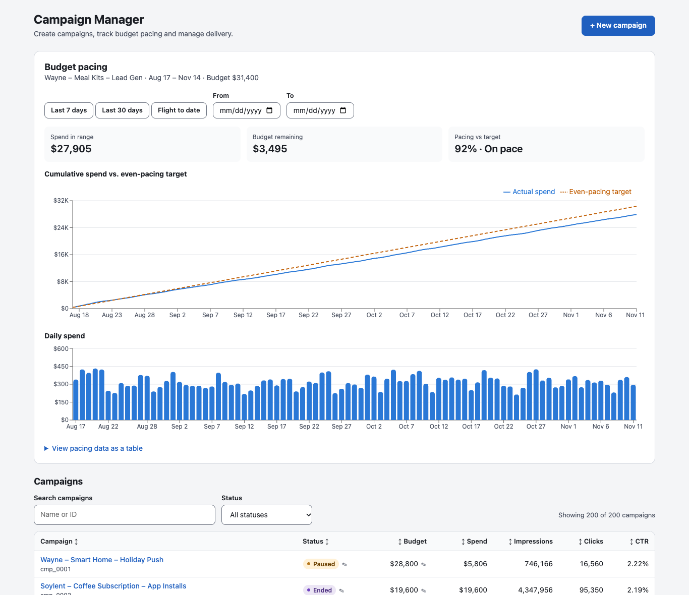

# Ads Campaign Dashboard

An advertiser-facing campaign management dashboard built with **React 18, TypeScript 5, Redux Toolkit and Recharts**. Advertisers can create campaigns with a multi-step wizard, watch budget pacing over time, and manage campaigns from a sortable, filterable, inline-editable table. A small **Node.js / Express** mock API serves 200 campaigns with randomized but realistic metrics.



## Features

| Feature | Where |
|---|---|
| **Multi-step campaign creation** (name → budget & dates → targeting → review) built to WCAG 2.1 AA: labelled controls, `fieldset`/`legend` groups, `aria-invalid` + `aria-describedby` errors, an error summary that links to fields, focus moved to each step's heading, focus-trapped modal that restores focus on close, AA-contrast tokens | `src/features/create/` |
| **Budget pacing charts** (Recharts): cumulative spend vs. even-pacing target, daily spend bars, pacing KPIs, date-range filter (presets + From/To date pickers) and a table view of the same data | `src/features/pacing/` |
| **Campaign table**: search + status filter, sortable columns (name, status, budget, spend, impressions, clicks, CTR) with `aria-sort`, inline editing of budget and status (keyboard: Enter saves, Escape cancels) with optimistic updates and rollback | `src/features/campaigns/` |
| **Redux Toolkit** store with a normalized `createEntityAdapter` for campaigns, async thunks, memoized `createSelector` filtering | `src/store/` |
| **Reusable UI library**: `Button`, `TextField`, `Select`, `DataTable`, `Modal`, `DatePicker`, `StatusBadge`, all styled from one theme of color, spacing, radius and typography tokens | `src/components/ui/`, `src/styles/theme.ts` |
| **Render performance**: `React.memo` on table rows, cells and chart components; stable column definitions; `react-window` virtualization when a table has more than 100 rows | `src/components/ui/DataTable.tsx`, `src/features/pacing/PacingCharts.tsx` |
| **CI**: GitHub Actions runs lint, type-check and build on every push / PR | `.github/workflows/ci.yml` |

## Architecture

```
┌──────────────────────────── Browser (Vite + React 18) ────────────────────────────┐
│                                                                                   │
│   App ─┬─ CreateCampaignWizard ──(Modal, TextField, Select, DatePicker)           │
│        ├─ BudgetPacingPanel ── PacingCharts (Recharts, memoized)                  │
│        └─ CampaignTable ── DataTable (sort, memo rows, react-window) ── InlineEdit │
│                │                                     ▲                            │
│        dispatch(thunk)                        useAppSelector                      │
│                ▼                                     │                            │
│   Redux Toolkit store ── campaigns slice: entity adapter { ids, entities },       │
│                           filters, optimistic edit rollback                       │
│                │                                                                  │
│          api/client.ts (fetch)                                                    │
└────────────────┼──────────────────────────────────────────────────────────────────┘
                 │  /api/*  (Vite dev/preview proxy)
┌────────────────▼──────────────────────────┐
│ Express mock API  (server/)               │
│  GET   /api/campaigns                     │
│  GET   /api/campaigns/:id/spend?from&to   │
│  POST  /api/campaigns                     │
│  PATCH /api/campaigns/:id  {budget,status}│
│  seeded PRNG → 200 campaigns + daily spend│
└───────────────────────────────────────────┘
```

**Why the table stays fast:** the entity adapter replaces only the edited campaign object, column definitions are memoized (selection is passed through context, not columns), and each row is `React.memo`'d. A sort or edit therefore re-renders only rows whose data or position changed. With 200 campaigns, only the ~17 visible rows are mounted.

### Layout

```
server/                  Express mock API + deterministic data generator
scripts/                 measure-sort-latency.mjs (Puppeteer + React Profiler)
src/
  api/                   typed fetch client
  components/ui/         design-system components (Button, TextField, Select, DataTable, Modal, DatePicker, StatusBadge)
  features/
    campaigns/           campaign table, filters, inline edit cells
    create/              multi-step creation wizard + validation
    pacing/              budget pacing panel and Recharts charts
  store/                 Redux Toolkit store and campaigns slice
  styles/                theme tokens, global styles
  perf.ts                React Profiler hook used by the measurement script
```

## Running locally

Requires Node.js 20+.

```bash
npm install
npm run dev          # mock API on :4000 + Vite dev server on http://localhost:5173
```

Other scripts:

```bash
npm run lint         # ESLint (typescript-eslint, react-hooks, jsx-a11y)
npm run typecheck    # tsc --noEmit
npm run build        # production build → dist/
npm start            # build, then serve dist/ (vite preview on :4173) + mock API
npm run measure:sort # sort-latency benchmark (needs Google Chrome, see below)
```

Mock API env vars: `PORT` (4000), `CAMPAIGN_COUNT` (200), `API_LATENCY_MS` (150, simulated network delay).

## Results

Measured with `npm run measure:sort` on an Apple Silicon MacBook (Chrome headless, macOS). The script builds a production bundle with React's profiling build enabled, starts the mock API with **200 campaigns** and 0 ms API latency, then clicks every sortable column header (ascending, then descending) for 5 rounds. That is 70 real mouse clicks per run, after one unrecorded warm-up click.

- **Click → next paint**: from the click event's `timeStamp` until the frame after React commits (`requestAnimationFrame` then a macrotask). This is the latency the user perceives.
- **React commit**: `<Profiler>` `actualDuration` for the table subtree.

| Metric (200 campaigns, n = 70 sorts) | Median | p95 | Max | Target |
|---|---|---|---|---|
| Sort click → next paint | **9.4 ms** | **17.6 ms** | 18.2 ms | < 200 ms ✅ |
| React commit (Profiler) | 2.0 ms | 2.5 ms | 3.1 ms | n/a |
| Sort click → next paint, 4× CPU throttle | 12.4 ms | 18.6 ms | 18.9 ms | < 200 ms ✅ |
| Table rows mounted in DOM (virtualized) | 17 of 200 | | | |

Click → paint is bounded below by waiting for the next frame (~16.7 ms at 60 Hz), so most of the p95 is frame alignment, not work. Chrome's CPU throttling is coarse for tasks this short (~2 ms), so treat the 4× row as indicative only. Numbers will vary by machine. Re-run the script to reproduce.

## Accessibility notes

- All form controls have visible `<label>`s. Checkbox sets use `fieldset`/`legend`, and required fields carry `aria-required`.
- Errors are linked with `aria-describedby`, flagged with `aria-invalid`, announced through `role="alert"`, and receive focus.
- The modal uses `role="dialog"` + `aria-modal` and is labelled by its title. It traps Tab, closes on Escape, makes `#root` `inert` while open, and restores focus to the trigger.
- The table uses ARIA table roles with `aria-rowcount`/`aria-rowindex` so virtualized rows keep their position, `aria-sort` on headers, and keyboard-operable sort buttons and inline editors.
- Status is never shown by color alone: badges always include text. Chart series differ by both color and dash pattern, and a data-table view is available.
- Text and control colors meet AA contrast (≥ 4.5:1 text, ≥ 3:1 control borders). Focus rings are always visible, and `prefers-reduced-motion` is respected.
- During development the app was checked with axe-core (WCAG 2.0/2.1 A + AA rules) on the main view and inside the open wizard: 0 violations.
